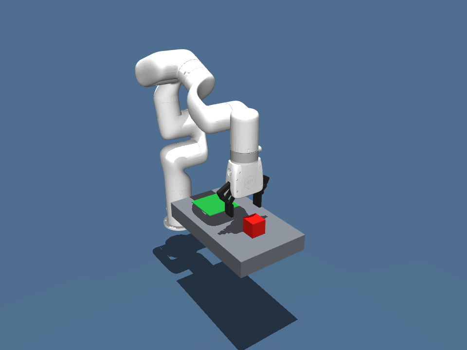
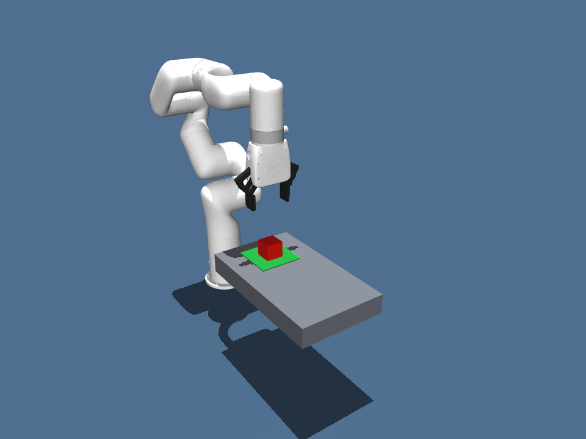

# MuJoCo xArm7 Agent Demo

Windows 上的机械臂任务编排演示：DeepSeek 将自然语言解析为受约束的任务，ROS 2 节点按单机械臂资源顺序执行任务，MuJoCo 负责物理仿真和结果验证。




## 当前已实现

- xArm7 机械臂、夹爪、方块和目标区的 MJCF 场景。机械臂采用 MuJoCo Menagerie 的 [xArm7 模型](https://github.com/google-deepmind/mujoco_menagerie/tree/main/ufactory_xarm7)，保留原模型的 BSD-3-Clause 许可证。
- 基于末端位姿雅可比的逆运动学，以及接近、夹取、抬升、搬运、释放、撤离的确定性执行流程。
- 根据指尖接触、方块抬升及最终位置判断物理任务成败；夹爪不闭合时会判失败。
- ROS 2 Jazzy Topic 桥接：任务命令、阶段事件、关节状态、单机械臂任务队列、重复请求拒绝与运行中取消。
- DeepSeek JSON 任务解析器：只接受场景中的物体和目标，模型不能输出关节控制量。

## 快速运行

从项目根目录执行：

```powershell
pixi install
pixi run python -m mujoco_demo.run_pick_place --screenshots-dir artifacts
pixi run python -m mujoco_demo.run_pick_place --viewer
pixi run test
```

无界面运行返回结构化阶段记录，并在 `artifacts/` 生成截图。`--viewer` 会以实时速度显示动作，关闭窗口后退出。

ROS 2 使用独立的 Pixi 环境。桥接节点默认无界面。先在终端 A 启动，再在终端 B 发送离线任务：

```powershell
pixi run --manifest-path ros2/pixi.toml python ros2/bridge_node.py
pixi run --manifest-path ros2/pixi.toml python ros2/agent_client.py --offline
```

若要观看完整的 Agent → ROS 2 → MuJoCo 动作，在终端 A 的桥接命令末尾加 `--viewer`。收到任务后会打开 MuJoCo 窗口，按仿真时间显示抓取和放置；任务结束后关闭窗口即可退出该桥接进程。

真实自然语言解析从项目根目录的 `.env` 或进程环境读取 `DEEPSEEK_API_KEY`：

```powershell
pixi run --manifest-path ros2/pixi.toml python ros2/agent_client.py "把红色方块放到绿色目标区"
```

任务队列与节点通信的独立检查：

```powershell
pixi run --manifest-path ros2/pixi.toml smoke
pixi run --manifest-path ros2/pixi.toml smoke-queue
```

## 边界

当前场景只有一个方块和一个目标区，物体定位直接读取仿真状态，不涉及视觉识别。ROS 2 桥接使用带请求 ID 的 Topic 消息；尚未实现自定义 Action、真机驱动或端侧安全控制。
