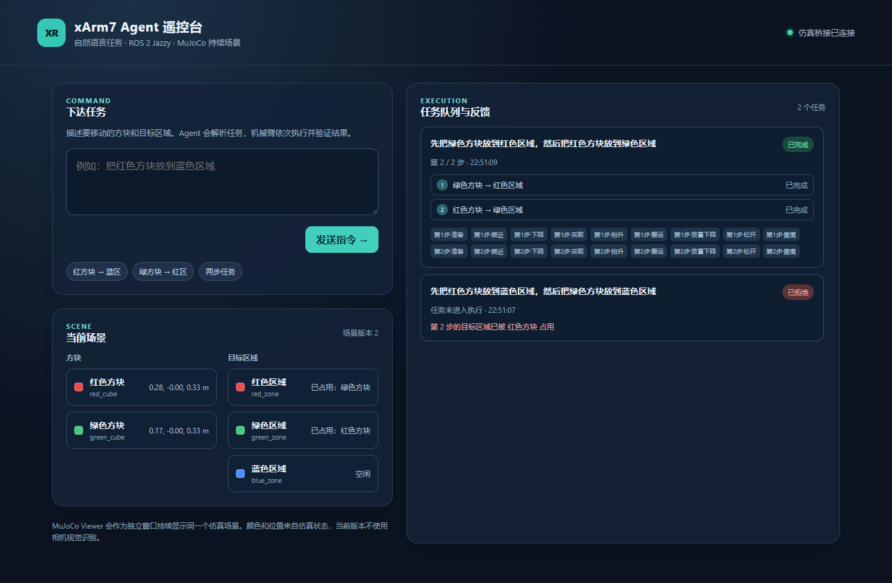
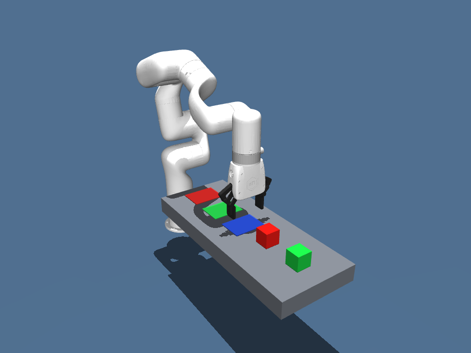
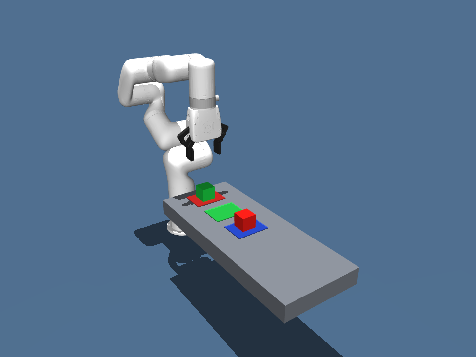

# MuJoCo xArm7 Agent 遥控平台

在 Windows 11 上用自然语言持续控制仿真机械臂。浏览器遥控台负责下达指令和展示状态；独立的 MuJoCo Viewer 持续显示 xArm7 在同一场景中的动作。DeepSeek 将指令解析为有序的高层任务计划，ROS 2 Jazzy 传递每一步命令、阶段事件和场景状态，MuJoCo 负责物理执行与结果验证。





## 已验证的能力

- 两个方块、三个颜色目标区；六种物体到区域的单任务组合均完成物理抓取、抬升、放置和稳定性验证。
- 同一个仿真场景连续执行多条任务；目标占用、未知物体、另一块方块位移和夹爪未抓起会被检测。
- DeepSeek 根据当前场景目录提取最多四个高层搬运目标；平台按占用情况生成可执行的 `pick_place` 步骤，并在运动前检查整份计划。只有每一步均通过物理验收才标记整条指令成功。模型不生成关节角或控制代码。
- 当两个方块占据彼此的目标区时，平台会利用空闲区域补出临时搬运步骤；例如交换红、绿区中的方块会生成三步计划，并逐步校验物理结果。
- 若指令中的所有目标在当前场景中已经满足，平台直接返回成功并标注“目标已满足，无需移动机械臂”；该任务没有 ROS 2 搬运步骤，场景版本保持不变。
- ROS 2 Topic 桥接提供排队、去重、取消、阶段反馈、关节状态和带版本的场景快照。
- 浏览器遥控台显示连接状态、物体与区域、自然语言输入、任务队列、执行阶段、拒绝原因和取消操作。

机械臂模型来自 MuJoCo Menagerie 的 [xArm7](https://github.com/google-deepmind/mujoco_menagerie/tree/main/ufactory_xarm7)，保留原模型的 BSD-3-Clause 许可证。

## 启动浏览器遥控台与 MuJoCo Viewer

先在项目根目录执行 `pixi install`。项目根目录的 `.env` 或进程环境需提供 `DEEPSEEK_API_KEY`；该文件已被 Git 忽略。然后分别打开两个终端：

```powershell
# 终端 A：持续运行同一 MuJoCo 场景与 Viewer
pixi run --manifest-path ros2/pixi.toml python ros2/bridge_node.py --multi --viewer

# 终端 B：DeepSeek、任务记录与浏览器 API
pixi run --manifest-path ros2/pixi.toml python ros2/control_platform.py
```

浏览器访问 `http://127.0.0.1:8765`。可以依次发送两条单任务，也可以一次输入“先把绿色方块放到红色区域，然后把红色方块放到绿色区域”。后一步会读取前一步完成后的场景；若后续步骤的目标被占用，整条计划会在机械臂动作前被拒绝。关闭两个终端即可停止服务。

## 代码模块

| 模块 | 主要职责 |
| --- | --- |
| `src/mujoco_demo/platform/` | DeepSeek 规划、父任务调度、HTTP/SSE 遥控台和 ROS 2 技能客户端 |
| `src/mujoco_demo/robot_runtime/` | 持续运行的 MuJoCo 场景、运动执行、物理验收和 ROS 2 桥接 |
| `src/mujoco_demo/shared/` | 计划、单步任务和 Topic 消息契约 |

上述两个运行模块可分别通过 `python -m mujoco_demo.robot_runtime.bridge_node --multi --viewer` 和 `python -m mujoco_demo.platform.control_platform` 启动，需在 ROS 2 Pixi 环境内执行。前面的 `ros2/*.py` 启动命令继续可用。当前传输仍为 Topic；Action 迁移见后续计划。

## 命令行与验收

```powershell
# 原单方块物理基线，可独立观看或生成截图
pixi run python -m mujoco_demo.run_pick_place --viewer
pixi run python -m mujoco_demo.run_pick_place --screenshots-dir artifacts

# 物理测试和 ROS 2 连续任务检查
pixi run test
pixi run --manifest-path ros2/pixi.toml smoke-multi
pixi run --manifest-path ros2/pixi.toml smoke-plan
```

后续架构路线见 [Agent 平台与机器人运行时拆分计划](docs/agent-platform-robot-runtime-plan.md)；已完成的多物体阶段记录在 [多物体机械臂 Agent 遥控平台实施计划](docs/multi-object-control-platform-plan.md)。

## 当前边界

物体的颜色和位置来自仿真元数据，没有相机视觉识别。目前唯一执行类技能是 `pick_place`；ROS 2 桥接使用 Topic 消息，自定义 Action 与真机驱动尚未接入。浏览器任务记录保存在平台进程内，服务重启后会清空。所有验证均在仿真中完成。
